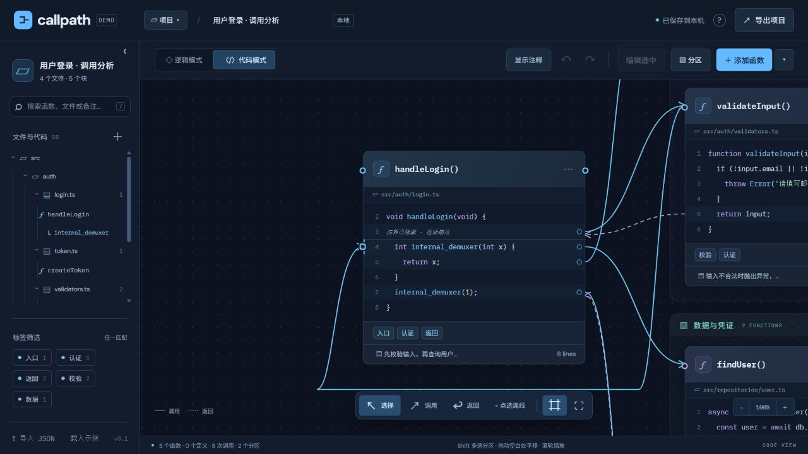
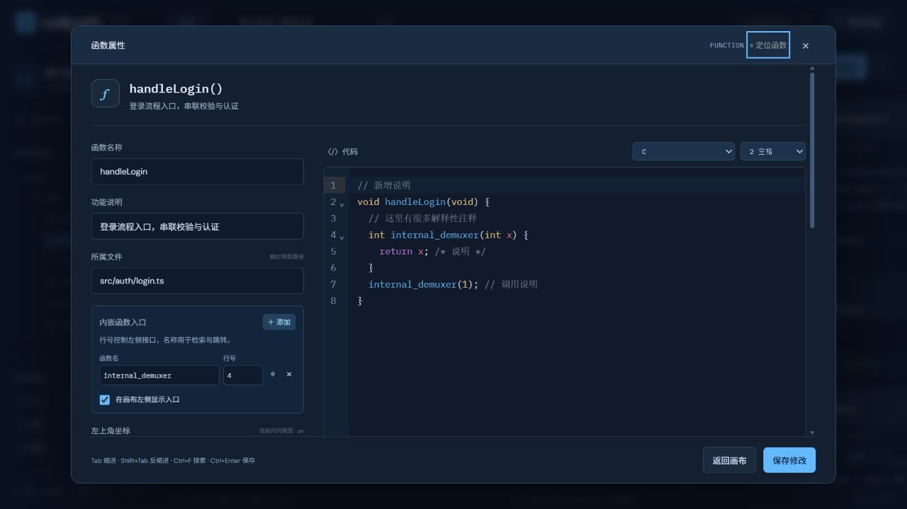

# Callpath · 函数调用画布

把函数、代码与调用关系放在同一张画布上。

Callpath 是一个交互式代码关系整理工具，适合阅读源码、梳理调用链，以及记录和讲解程序逻辑。通过手动添加代码块、连接调用与返回路径，将分散在不同文件中的代码组织成可以浏览、追踪和编辑的函数地图。

支持纯静态运行，也支持通过 Rust 后端自托管，使用账号保存项目并在多台设备之间同步。

> 当前函数、代码与调用关系均由用户手动维护。Callpath 不会自动解析仓库生成调用图，也不会执行画布中的代码。

## 界面预览



<details>
<summary>查看函数编辑器</summary>



</details>

截图展示本地模式的示例项目。

## 主要功能

### 在逻辑与代码之间切换

- **逻辑模式**：以函数名称展示整体调用关系。
- **代码模式**：展开函数代码，将调用与返回连接到具体代码行。
- 两种模式共享代码块与分区的位置，切换时保持视角；代码行使用稳定 ID，插入代码后连接锚点随之更新。
- 支持函数、结构体和宏定义块，以及嵌套函数作用域和内嵌函数入口。

### 整理和追踪调用链

- 分别记录调用与返回，为连线添加标题、参数、返回值、条件和备注。
- 关联的调用与返回沿同一路径并排显示，通过实线、虚线和方向区分。
- 按目录、文件、函数浏览代码，支持搜索、标签筛选和上游 / 下游追踪。
- Ctrl + 单击代码中的函数名可定位对应代码块；存在同名函数时结合调用关系、作用域和文件定位。
- 使用分区组织相关函数，拖动分区可整体移动成员。

### 在画布上编辑代码

- 集成 CodeMirror 6，支持语法高亮、自动缩进、括号补全、代码折叠和搜索。
- 支持 JavaScript、TypeScript、Python、Rust、C、C++、Java、Go、SQL、JSON 与纯文本。
- 画布支持平移、缩放、网格吸附、适应视图、键盘移动及撤销 / 重做。
- 可切换画布中的注释显示，编辑器与导出的 JSON 保留完整代码。

### 保存和管理项目

- 新建、切换、重命名和删除项目，支持从「最近删除」恢复。
- 支持项目 JSON 导入 / 导出，以及当前视图 SVG 导出。
- **本地模式**：项目保存在当前浏览器，无需账号或数据库。
- **账号模式**：每个账号独立保存工作空间，支持服务器自动保存、断网草稿与版本冲突检测。
- **只读分享**：点击右上角「分享项目」创建免登录链接；分享包含当前项目的代码、备注和调用链，其他项目保持私有。编辑后点击「更新分享」发布新快照，可随时撤销链接。

## 快速开始

### 本地体验

下载或克隆仓库后，在项目根目录运行：

```bash
node server.mjs
```

打开 **http://127.0.0.1:4173**。

此模式只需 Node.js。仓库已包含构建好的编辑器，无需先安装前端依赖。也可以将 `dist/` 目录部署到静态网站托管服务。

### 启用账号与跨设备保存

Rust 后端同时提供网页与 API，使用 SQLite 保存账号和项目。支持 Docker Compose，也支持直接编译运行。

在项目根目录运行以下命令，可通过 Docker 在本机体验账号模式：

```bash
# Windows PowerShell 使用 Copy-Item .env.example .env
cp .env.example .env
```

将 `.env` 中的 `ALLOW_REGISTRATION` 改为 `true`，允许创建自己的账号，再启动：

```bash
docker compose up -d --build
```

打开 **http://127.0.0.1:8080**，注册并登录。注册完成后，可将 `ALLOW_REGISTRATION` 改回 `false`，并再次运行启动命令关闭后续注册。

公网部署、命令行创建账号、HTTPS、子路径部署、备份恢复和版本更新，请参阅 **[部署指南](DEPLOY.md)**。

## 基本操作

1. 点击「添加函数」，填写名称、所属文件和代码，也可先点击「载入示例」体验。
2. 切换到逻辑模式或代码模式，拖动函数标题调整位置。
3. 点击底部「调用」或「返回」，依次选择起点和终点；代码模式可连接具体代码行。按 Esc 退出连线模式。
4. 点击连线填写参数、返回值或备注；双击函数编辑内容。
5. 使用文件树、搜索、标签和上下游追踪浏览项目；Shift 多选函数后可创建分区。
6. 本地模式自动保存到浏览器，账号模式自动保存到服务器；需要迁移或留存副本时导出 JSON。

| 操作 | 快捷键 |
| --- | --- |
| 编辑选中的函数或分区 | Enter |
| 多选函数 | Shift + 单击 |
| 平移画布 / 移动选中块 | 方向键 |
| 增大键盘移动步长 | Shift + 方向键 |
| 定位代码中的函数 / 连线终点 | Ctrl + 单击 |
| 退出连线模式 | Esc |
| 编辑器内搜索 | Ctrl + F |
| 编辑器缩进 / 取消缩进 | Tab / Shift + Tab |

## 数据与当前限制

- 每个项目最多 **200 个代码块、1000 条连线**，每个代码块最多 **400 行代码**。
- 每个账号最多 **100 个活动项目、1000 个最近删除项目**，工作空间大小上限为 **20 MiB**。
- 尚未进行大图性能验证，也未实现虚拟渲染或分段加载，适合围绕具体模块和调用链整理代码。
- 账号数据按完整工作空间快照保存。多设备或多标签页并行修改发生冲突时，会暂停自动写入，需要保留副本并选择后续版本；暂不自动合并修改。
- 当前不提供项目共享或多人实时协作。
- 本地模式的数据属于当前浏览器与站点地址。清理浏览器数据或更换地址前，请先导出项目。

## 开发与验证

前端使用原生 JavaScript 与 CodeMirror 6；后端使用 Rust、Axum、Tokio 和 SQLx，数据保存在 SQLite 中。

仅修改画布逻辑、样式或静态页面时，可编辑 `dist/` 中对应文件并通过本地服务预览。修改编辑器源码或依赖后，需要重新构建编辑器：

```bash
pnpm install --frozen-lockfile
pnpm run build:editor
```

前端检查与测试：

```bash
pnpm run check
node --test tests/*.test.mjs
```

后端测试与静态检查：

```bash
cargo test --locked --manifest-path backend/Cargo.toml
cargo clippy --locked --manifest-path backend/Cargo.toml --all-targets -- -D warnings
```

测试覆盖代码行锚点、调用追踪、嵌套作用域、项目管理、数据导入、断网同步、账号隔离与版本冲突等行为。

## 项目结构

```text
.
├── dist/                 # 网页、画布逻辑与预构建编辑器
├── src/                  # 编辑器源码与依赖声明
├── scripts/              # 编辑器构建脚本
├── backend/              # Rust API、账号系统与 SQLite 持久化
├── tests/                # 前端测试
├── deploy/               # 通用反向代理与 systemd 配置示例
├── docs/images/          # README 截图
├── server.mjs            # 本地静态预览服务
├── Dockerfile
├── compose.yaml
└── DEPLOY.md             # 部署与维护说明
```

## 许可证

本项目采用 [MIT License](LICENSE)。第三方依赖遵循各自的许可证；预构建编辑器的许可声明见 [LICENSES.txt](dist/vendor/LICENSES.txt)。
